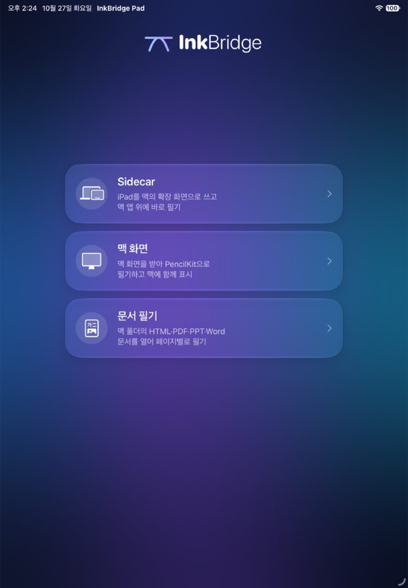
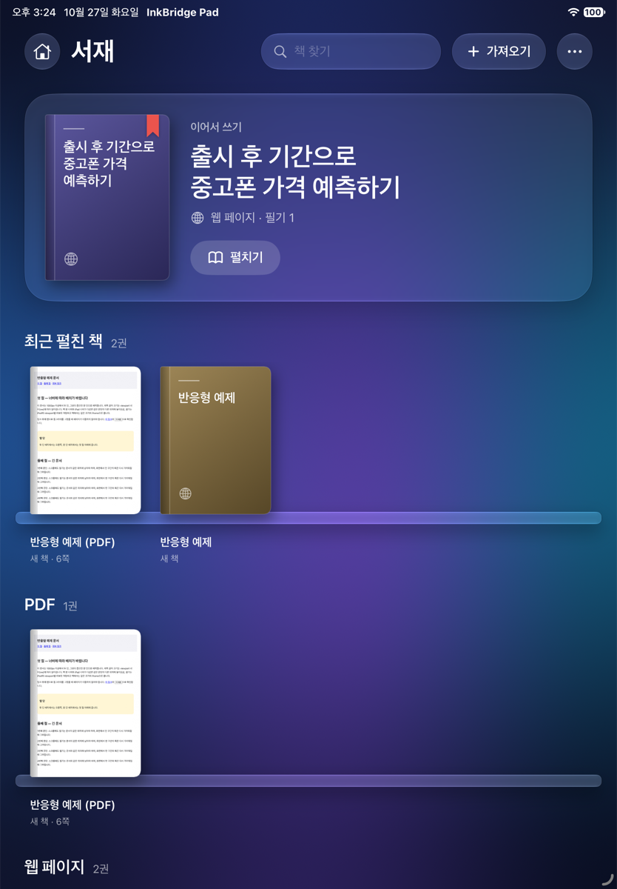

# InkBridge

> ⭐ **이 저장소를 참고하셨다면 Star를 꼭 남겨 주세요!** 다음 작업에 큰 힘이 됩니다.
> If this repo helped you, please leave a star.

**Apple Pencil로 맥 화면과 문서 위에 바로 쓰는 iPad + Mac 필기 도구입니다.**

InkBridge lets you write with Apple Pencil over your Mac's screen and documents. It has three versions that share one iPad app, and everything stays on your local network: no account and no cloud server.

<p align="center">
  
  
</p>

## 세 가지 버전

| 버전 | 어디서 실행 | 이럴 때 | 필기 위치 |
|---|---|---|---|
| **Sidecar** | 맥 (`sidecar/`) | 강의·화면 공유 중 맥 앱 위에 바로 쓸 때 | 맥 화면 좌표 |
| **맥 화면** | 맥 + iPad (`Mac/`, `iPad/`) | 맥 화면을 iPad로 받아 PencilKit으로 쓸 때 | 맥 디스플레이별 |
| **서재** | 맥 서버 + iPad (`library/`, `iPad/`) | PDF·PPT·Word·HTML 문서를 꽂아 두고 꺼내 쓸 때 | 문서 페이지별 |

iPad 앱 **InkBridge Pad**를 열면 세 버전 중 하나를 고르는 처음 화면이 나옵니다. Sidecar판은 맥에서 실행되므로 iPad 앱에서는 시작 방법만 안내합니다.

## 필요한 것

- Apple Silicon Mac, macOS 14 이상 (Sidecar판은 macOS 13 이상)
- iPad, iPadOS 18 이상, Apple Pencil (iPadOS 26 이상에서 유리 재질)
- Xcode 26 이상 (iPad 앱 설치), [XcodeGen](https://github.com/yonaskolb/XcodeGen) (`brew install xcodegen`)
- Node.js 24 이상 (서재 서버, 외부 패키지 없음)
- 같은 Wi-Fi에 연결된 맥과 iPad

App Store·TestFlight 배포본은 없습니다. 아래처럼 직접 빌드해 설치합니다.

## 설치

```sh
git clone https://github.com/jasonwpgml/InkBridge.git
cd InkBridge
xcodegen generate
```

### iPad 앱 (InkBridge Pad)

1. `InkBridge.xcodeproj`를 Xcode에서 엽니다.
2. `InkBridgePad` 타깃 → Signing & Capabilities에서 본인의 Apple 개발 팀을 고릅니다. 무료 개인 팀도 되지만 7일마다 다시 설치해야 합니다.
3. iPad를 연결하고 개발자 모드를 켠 뒤, 그 iPad를 대상으로 실행합니다.

명령줄로 설치하려면 팀 ID를 넘깁니다.

```sh
xcodebuild -project InkBridge.xcodeproj -scheme InkBridgePad -destination 'platform=iOS,name=<iPad 이름>' \
  -derivedDataPath build/DerivedData -allowProvisioningUpdates DEVELOPMENT_TEAM=<팀 ID> build
```

### 맥 앱 (InkBridge Mac, 맥 화면 버전)

```sh
./scripts/build-mac.sh          # build/InkBridge Mac.app 생성 (임시 서명)
```

화면 기록 권한을 재실행 후에도 유지하려면 개발 인증서로 서명합니다: `INKBRIDGE_SIGNING_IDENTITY='Apple Development: …' ./scripts/build-mac.sh`. Xcode에서 `InkBridgeMac` 스킴을 실행해도 됩니다.

### Sidecar판

```sh
./sidecar/build.sh              # sidecar/InkBridge.app 생성
```

## 사용법

### Sidecar

1. 맥에서 `sidecar/InkBridge.app`을 엽니다.
2. 맥의 제어 센터 → 화면 미러링에서 iPad를 고릅니다(확장 또는 미러링).
3. iPad 화면 위쪽의 도구 막대에서 **필기 시작**을 누르고 Pencil로 씁니다. `⌥⌘D`로 필기와 맥 조작을 오가고, `Fn`을 누르고 있는 동안에는 잠깐 맥을 조작할 수 있습니다.

단축키, 지우개, 저장(`.inkbridge`·PNG)은 [sidecar/README.md](sidecar/README.md)에 있습니다.

### 맥 화면

1. 맥에서 **InkBridge Mac**을 열고 로컬 네트워크와 화면 기록 권한을 허용합니다. 6자리 연결 코드가 나옵니다.
2. iPad에서 InkBridge Pad → **맥 화면**을 누르고, 맥을 고른 뒤 코드를 입력합니다.
3. 맥에서 보낼 디스플레이를 골라 **화면 전송 시작**을 누릅니다.
4. iPad에 맥 화면이 나오면 Pencil로 씁니다. 필기는 맥 화면의 같은 위치에도 표시됩니다.

- 필기는 PencilKit이 iPad에서 바로 그리므로 맥의 응답을 기다리지 않습니다. 화면별로 iPad에 자동 저장됩니다.
- 화면은 긴 변 최대 1600px, 최대 20fps JPEG로 보냅니다. 영상과 필기는 암호화가 필수인 MultipeerConnectivity 세션으로 주고받습니다.
- iPad에서 맥 앱을 클릭·스크롤하는 원격 조작과 오디오는 지원하지 않습니다.
- ‘로컬 네트워크’ 팝업에서 거부했다면 iPad 설정에서 InkBridge Pad의 로컬 네트워크를 켜 주세요.

### 서재

1. 맥에서 문서 폴더를 지정해 서버를 켭니다.

   ```sh
   node library/server.mjs ~/Documents/수업자료
   ```

   터미널에 `http://<맥 이름>.local:5173/?t=<토큰>` 형태의 **iPad 권장 주소**가 나옵니다.
2. iPad에서 InkBridge Pad → **서재**를 누르고 그 주소를 붙여넣습니다. 한 번만 하면 됩니다.
3. 폴더의 문서가 종류별 책장(PDF·슬라이드·문서·웹 페이지)에 꽂힙니다. PDF·PowerPoint·Keynote·Word·Pages 파일은 맥이 쪽 이미지로 바꾸는 동안 ‘책으로 만드는 중’으로 보이고, 첫 쪽이 표지가 됩니다.
4. **가져오기**로 iPad의 파일을 맥 폴더의 `imported/`에 넣을 수 있습니다. 맥 폴더에 직접 넣은 파일도 바로 꽂힙니다.
5. 책을 누르면 펼쳐지고 Pencil로 씁니다. 필기는 페이지(쪽)별로 맥 폴더의 `.pencil-review/`에 저장됩니다. 필기가 있는 책에는 빨간 책갈피가 붙고, 마지막으로 펼친 책은 위쪽 **이어서 쓰기**에 놓입니다.
6. 도구 막대의 ⋯ → **서재로**를 누르면 책장으로 돌아옵니다.

- 같은 문서를 iPad Safari나 맥 브라우저(`http://localhost:5173/`)로도 열 수 있습니다. 맥의 **필기 보기**(`/__pr/view`)는 iPad에서 쓰는 선을 실시간으로 보여 줍니다.
- 뷰어의 **내보내기**는 필기마다 아래 글자·선택자를 적은 `REVIEW.md`를 만듭니다. AI 에이전트에게 “이 리뷰 반영해 줘”와 함께 건네는 용도입니다.
- 자세한 내용(토큰·끊김 처리·동적 페이지·변환 규칙)은 [library/README.md](library/README.md)에 있습니다.

### 필기 도구 (맥 화면·서재 공통)

- 하단의 떠 있는 유리 도구 막대에서 펜·형광펜·지우개, 색 6개, 굵기 3단계를 고릅니다. 선택한 도구를 다시 누르면 세부 설정(펜 종류: 젤펜·볼펜·만년필, 0.5pt 단위 굵기, 색 12개)이 열립니다.
- Pencil 더블탭·스퀴즈는 iPad 설정 → Apple Pencil에서 고른 동작을 따릅니다. 스퀴즈(기본값)는 펜 끝 옆에 빠른 팔레트를 엽니다.
- 손가락은 기본적으로 스크롤·조작용입니다. ⋯에서 손가락 필기를 켤 수 있습니다.
- 배경이 복잡해 도구 막대가 잘 안 보이면 ⋯ → **불투명 모드**를 켭니다.

## 프로젝트 구조

```
iPad/         InkBridge Pad (SwiftUI): 처음 화면, 맥 화면 모드, 서재 책장, 공용 도구 막대
Mac/          InkBridge Mac: 화면 캡처·전송, 받은 필기 오버레이
Shared/       맥·iPad 공용 패킷 형식과 연결(MultipeerConnectivity)
Tests/        프로토콜·도구 설정 검사 (scripts/check.sh)
library/      서재 서버 (Node, 의존성 없음): 문서 제공·필기 저장·변환·가져오기
sidecar/      Sidecar판 맥 앱 (Swift/AppKit, 독립 빌드)
scripts/      빌드·검사 스크립트
docs/         개발 기록과 스크린숏
project.yml   XcodeGen 설정 (InkBridge.xcodeproj는 여기서 생성)
```

## 개발

```sh
./scripts/test-all.sh   # 모든 자동 검사: 프로토콜·맥 컴파일, 서재 서버, Sidecar판
```

AI 코딩 에이전트와 함께 작업한다면 [AGENTS.md](AGENTS.md)부터 읽게 하세요. 구조, 명령, 지켜야 할 규칙, 확인 방법이 정리되어 있습니다. 날짜별 변경과 검증 범위는 [docs/HISTORY.md](docs/HISTORY.md)에 있습니다.

## 알려진 한계

- 실제 Apple Pencil의 더블탭·스퀴즈와 체감 지연은 기기마다 다를 수 있으며, 일부 조합은 시뮬레이터로만 확인했습니다.
- 서재의 필기는 웹 페이지가 그리므로 맥 화면 모드의 PencilKit 획과 모양·반응 속도가 조금 다릅니다.
- PowerPoint·Word 변환은 맥의 Keynote·Pages를 제어해 PDF로 만든 뒤 진행합니다. 처음 한 번 macOS가 제어 권한을 묻습니다.
- 맥과 iPad 앱은 같은 버전끼리 써야 합니다(필기 패킷 형식이 이전 버전과 호환되지 않음).

## 라이선스

[MIT](LICENSE) © 2026 JSonJh. Sidecar판의 유리 재질 조정에는 MIT 라이선스 코드가 참고로 쓰였습니다([sidecar/THIRD_PARTY_NOTICES.txt](sidecar/THIRD_PARTY_NOTICES.txt)).

Made by JSonJh (https://github.com/jasonwpgml)
